# Outline

<!-- {style="font-size: 132px;"} -->

::: nonincremental
-   Motivation

-   Background

-   Project 1

    -   Object detection network performance in identifying footwear characteristics

-   Project 2 and project 3

    <!-- * Classification network performance on challenging geometric patterns -->

    <!-- * Factors influencing polygon classification by neural networks -->

-   Questions and comments
:::

# [Motivation]{style="font-size: 92px;"}

<!-- ############################## page4 ####################### -->

## Forensic Footwear Evidence

[Motivation · 1/4]{style="font-size: 0.55em; color: #64748b;"}

::: notes
These projects were motivated by forensic footwear study

We wanted to evaluate footwear evidence. By footwear evidence, we mean the class characteristics.

:::

**Class Characteristics** can provide an association between a suspect and the scene [@hammer2018footwear]

::: columns
::: {.column .nonincremental width="45%"}
-   Outsole design
-   [Manufactured features]{.fragment .semi-fade-out fragment-index="0"}
-   [Physical sizes]{.fragment .semi-fade-out fragment-index="0"}
:::

::: {.column width="55%"}
::: {.compact-figures layout-ncol="1" style="margin-top: -30px; padding: 6px 12px;"}
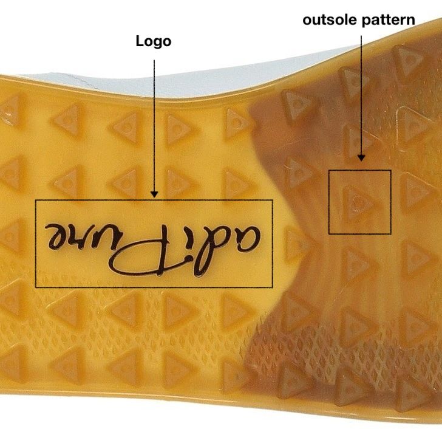{#fig-design .lightbox fig-align="center" height="200px"}

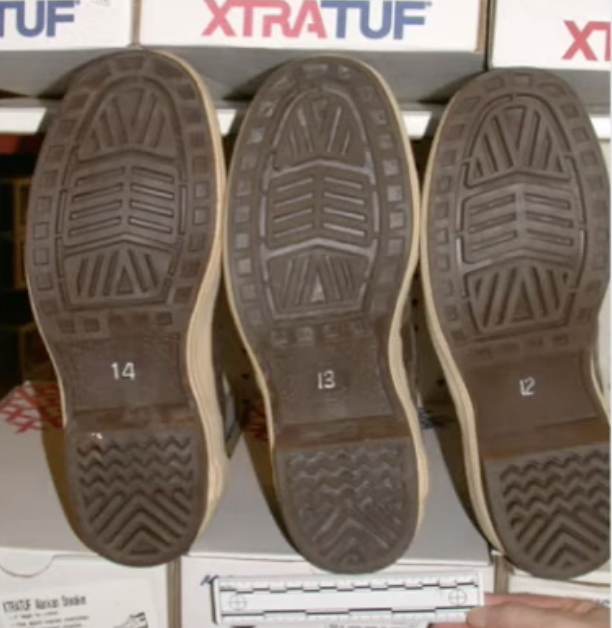{#fig-sizes .lightbox fig-align="center" height="200px"}
:::
:::
:::

::: {style="position: absolute; right: -14px; bottom: -30px; font-size: 12px; line-height: 1.2; color: #555; text-align: right;"}
Image sources: [1] @Adipure <br> [2] @hammer2018footwear
:::

<!-- ##########################3####### New Slide ######################## -->

## Frequency Study

[Motivation · 2/4]{style="font-size: 0.55em; color: #64748b;"}

Link the scenes at the local level

<!-- :::: {.fragment data-fragment-index="0"} -->

<!-- ::: incremental -->

<!-- -   How often a design may occur in a population -->

<!-- -   How often a random accidental characteristic is likely to repeat -->

<!-- ::: -->

<!-- :::: -->

<ul>

<li class="fragment" data-fragment-index="0">

How often a design may occur in a population

</li>

<li class="fragment" data-fragment-index="1">

How often a random accidental characteristic is likely to repeat

</li>

<li class="fragment" data-fragment-index="2">

Use pattern descriptions to characterize the types of shoes worn by a population <!-- $\hat{p}=\frac{}{}$  -->

</li>

<!-- <li class="fragment" data-fragment-index="2"> Estimate the distribution of classes $\hat{p}=\frac{}{}$ </li> -->

</ul>

<!-- Who is examining the evidence? -->

<!-- <ul> -->

<!--   <!-- <li class="fragment" data-fragment-index="3"> Collect footwear evidence from the scene </li> -->

<!--   <li class="fragment" data-fragment-index="4"> Examiners evaluate the evidence and interpret the features</li> -->

<!-- </ul> -->

<!-- #####################################？？？？？something new!!!! -->

<!-- ```{=html} -->

<!-- <style> -->

<!--   .reveal .center-captions figcaption { -->

<!--     text-align: center; -->

<!--   } -->

<!-- </style> -->

<!-- ``` -->

<!-- :::: {.center-captions layout-ncol=2 layout-valign="top" style="background: #f1f3f5; padding: 16px; border-radius: 10px; margin-top: -52px;"} -->

<!-- ::: {.fragment data-fragment-index="3"} -->

<!-- {height=200px fig-align="center"} -->

<!-- ::: -->

<!-- ::: {.fragment data-fragment-index="4"} -->

<!-- {height=200px fig-align="center"} -->

<!-- ::: -->

<!-- :::: -->

<!-- ################################# PAGE 6 ######################## -->

## Local Level

[Motivation · 3/4]{style="font-size: 0.55em; color: #64748b;"}

::: columns
::: {.column width="60%"}
```{=html}
<ul>
  <li class="fragment" data-fragment-index="0">
    There is a large volume of data
    <ul>
      <li>Data needs to be collected from local residents</li>
      <li>Automating the data processing is required</li>
    </ul>
  </li>
  <li class="fragment" data-fragment-index="1">
    The examiners evaluate evidence in the way humans do
    <ul>
      <li>The automated process needs to align with human judgement</li>
    </ul>
  </li>
</ul>
```
:::

::: {.column width="40%"}
::: {.fragment data-fragment-index="0" style="background: #ffffff; border-radius: 10px; padding: 46px;"}
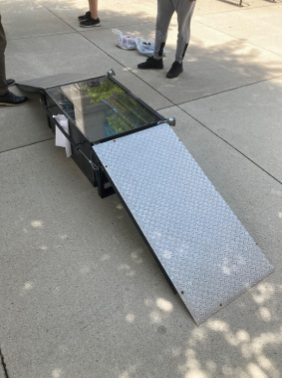{#fig-scanner width="100%" fig-alt="Collect" style="height: 600px; object-fit: contain;"}
:::
:::
:::

<!-- ##################### PAGE 7 ################################3 -->

## Tentative Solution

[Motivation · 4/4]{style="font-size: 0.55em; color: #64748b;"}

::: columns
::: {.column width="60%"}
```{=html}
<ul>
  <li>Neural network-based vision model
    <ul>
      <li class="fragment" data-fragment-index="0">
        Localize patterns
      </li>
      <li class="fragment" data-fragment-index="1">
        Classify the pattern within the detected bounding box
      </li>
    </ul>
  </li>
</ul>
```
:::

::: {.column width="40%"}
::: {#fig-pattern}
```{=html}
<div style="position:relative;">
  

  <div style="position:absolute; left:42%; top:40%; width:13%; height:17%;">
    <div class="fragment" data-fragment-index="0"
         style="position:absolute; inset:0; border:4px solid #FFFFFF; box-sizing:border-box;">
    </div>

    <div class="fragment" data-fragment-index="1"
         style="position:absolute; bottom:100%; left:0; background:#FFFFFF; color:black; padding:3px 8px; font-size:0.55em; white-space:nowrap;">
      triangle
    </div>
  </div>
</div>
```
Pattern localization and classification.
:::
:::
:::

<!-- ######################## PAGE 9 ############################# -->

# [Background]{style="font-size: 92px;"}

## The Pieces {#background-menu}

[Background · 1/2]{style="font-size: 0.55em; color: #64748b;"}

::: nonincremental
-   Automating the process: [neural networks](#nn)

-   Human making judgement: [human recognition](#human)

-   Do vision models recognize shapes the way humans do? <!-- (#nnhuman) -->

-   The coding of shoesoles is ambiguous
:::

::: {layout-ncol="1" layout-valign="top"}
<!--  -->

{#fig-solemate height="300px"}
:::

## Research Objectives

[Background · 2/2]{style="font-size: 0.55em; color: #64748b;"}

Do vision models recognize shapes the way humans do?

-   Neural network performance in identifying footwear characteristics
-   Network performance on challenging geometric shapes
-   Factors influencing neural network classification

::: notes
RIGHT!!!! NOT DOWN
:::

<!-- ######################## PAGE 25 ############################# -->

## Neural Networks Process Images for Various Tasks {#nn}

[Background · Neural network · 1/2]{style="font-size: 0.55em; color: #64748b;"}

Train with annotated data to get optimal weights in both the backbone and the head for specific tasks

::: {#fig-nndiagram}
```{=html}
<style>
  .rac-layout {
    display: grid;
    grid-template-columns: minmax(0, 4fr) minmax(0, 1fr);
    height: 360px;
  }

  .rac-rail {
    position: relative;
  }

  .rac-photo {
    position: absolute;
    left: var(--x);
    top: var(--y);
    width: var(--w);
    height: var(--h);
  }
  .rac-photo-name {
  position: absolute;
  top: -10px;
  left: 10px;
  padding: 2px 6px;
  background: rgba(0, 0, 0, 0.7);
  color: white;
  font-size: 14px;
}

  .rac-photo > img,
  .rac-banner > img {
    display: block;
    width: 100%;
    height: 100%;
    max-width: none;
    max-height: none;
    margin: 0;
    object-fit: contain;
  }

  .rac-box {
    position: absolute;
    left: 30%;
    top: 35%;
    width: 40%;
    height: 30%;
    border: 3px solid #e53935;
    box-sizing: border-box;
  }

  .rac-label {
    position: absolute;
    bottom: 100%;
    right: 0;
    padding: 2px 6px;
    background: black;
    color: white;
    font-size: 13px;
    white-space: nowrap;
  }

  .rac-banner {
  width: 80%;
  height: 400px;
  margin: -300px 0 0;
}
  .rac-banner {
  position: relative;
}

.rac-cover {
  position: absolute;
  z-index: 2;
  background: white;
  pointer-events: none;
}

.rac-photo-source {
  position: absolute;
  top: 356px;
  left: 0;
  width: 100%;
  text-align: center;
  font-size: 14px;
  line-height: 1.2;
  color: #555;
}

.reveal #fig-nndiagram {
  text-align: left;
}

.reveal #fig-nndiagram .rac-layout ul {
  display: block;
  margin: 0 !important;
  padding-left: 0 !important;
  list-style-position: inside;
}

.reveal #fig-nndiagram .rac-layout li {
  margin-left: 0;
  padding-left: 0;
}
</style>

<div class="rac-layout">
  <div>
    <ul style="position: relative; z-index: 1;">
      <li class="fragment" data-fragment-index="0">Classification</li>
      <li class="fragment" data-fragment-index="1">Object detection</li>
      <!-- <li class="fragment" data-fragment-index="2"> </li> -->
    </ul>
  </div>

  <div class="rac-rail">
    <div class="rac-photo fragment" data-fragment-index="0"
         style="--x: 20%; --y: -30px; --w: 60%; --h: 100px;">
      
      <span class="rac-photo-name">Robin 0.8</span>
    </div>

    <div class="rac-photo fragment" data-fragment-index="0"
         style="--x: 20%; --y: 90px; --w: 60%; --h: 100px;">
      
      <span class="rac-photo-name">Blue Jay 0.05</span>
    </div>

    <div class="rac-photo fragment" data-fragment-index="0"
         style="--x: 20%; --y: 210px; --w: 60%; --h: 115px;">
      
      <span class="rac-photo-name">House finch 0.15</span>
    </div>

    <div class="rac-photo fragment" data-fragment-index="1"
         style="--x: 20%; --y: 300px; --w: 60%; --h: 300px;">
      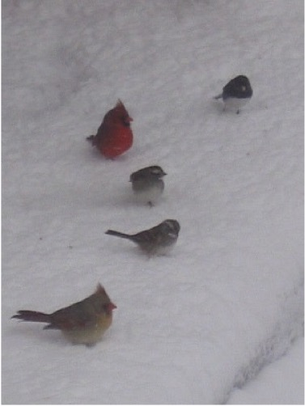
      <div class="rac-box" style="left: 28%; top: 30%; width: 20%; height: 15%;">
        <span class="rac-label">House finch</span>
      </div>
      
    
      <div class="rac-box" style="left: 10%; top: 64%; width: 35%; height: 15%;">
        <span class="rac-label">House finch</span>
      </div>
      
       <div class="rac-box" style="left: 38%; top: 43%; width: 20%; height: 8%;">
        <span class="rac-label">House finch</span>
      </div>
      
      <div class="rac-box" style="left: 40%; top: 53%; width: 20%; height: 10%;">
        <span class="rac-label">House finch</span>
      </div>
     
     <div class="rac-box" style="left: 70%; top: 28%; width: 15%; height: 8%;">
        <span class="rac-label">House finch</span>
      </div>
      
    </div>
  </div>
</div>

<div class="rac-banner">
  
  

  <div class="rac-cover fragment fade-out" data-fragment-index="0"
       style="left: 58.7%; top: 5%; width: 43%; height: 50%;"></div>

  <div class="rac-cover fragment fade-out" data-fragment-index="1"
       style="left: 58.7%; top: 55%; width: 43%; height: 50%;"></div>
</div>
```
Neural network diagram
:::

::: {style="position: absolute; right: -14px; bottom: -30px; font-size: 12px; line-height: 1.2; color: #555; text-align: right;"}
Image source: @deng2009imagenet
:::

## Model Training and Transfer Learning

[Background · Neural network · 2/2]{style="font-size: 0.55em; color: #64748b;"}

-   Training from scratch is expensive and requires large training data\
    <!-- * 5–6 days on two NVIDIA GTX 580 GPUs running in parallel, for a total of approximately 240–288 GPU-hours. -->

    -   ImageNet: a large-scale image dataset widely used to train and evaluate networks
    -   1.2 million images, 1000 classes

-   AlexNet [@alexnet]

    -   Accuracy: percentage of correct predictions

    -   59.3% accuracy on 50k test images

-   Reuse the backbone

    -   Initializing with transferred <br> features can improve generalization <br> performance [@transfer-learning]

::: {#fig-backbone}
```{=html}
<div>
  
</div>

<style>
  #fig-backbone {
    position: absolute;
    right: 10px;
    bottom: 5px;
    width: 520px;
    margin: 0;
  }

  #fig-backbone figcaption {
    margin: 2px 0 0;
    padding: 0;
    font-size: 16px;
    line-height: 1.25;
    text-align: center;
  }
</style>
```
A pretrained backbone can be used to extract features
:::

::: {style="position: absolute; left: 0px; bottom: -10px; font-size: 16px;"}

[← Background](#background-menu)

:::

::: {style="position: absolute; right: -14px; bottom: -30px; font-size: 12px; line-height: 1.2; color: #555; text-align: right;"}
Image source: @abstract
:::

<!-- ## Two Categories of Vision Models -->

<!-- [Background · Neural network · 3/3]{style="font-size: 0.55em; color: #64748b;"} -->

<!-- ```{=html} -->

<!-- <div style="display: grid; grid-template-columns: repeat(2, minmax(0, 1fr)); -->

<!--             column-gap: 98px; row-gap: 150px;"> -->

<!--   <div> -->

<!--     <h3 style="margin: 0 0 8px; font-size: 44px; text-align: left;"> -->

<!--     Convolutional neural network (CNN) -->

<!--     </h3> -->

<!--     <ul> -->

<!--       <li>Biological inspired hierarchical model</li> -->

<!--       <li>Local features are integrated into more complex features</li> -->

<!--       <li>Assumes locality + translation equivariance </li> -->

<!--     </ul> -->

<!--   </div> -->

<!--   <div> -->

<!--     <h3 style="margin: 0 0 8px; font-size: 44px; text-align: left;"> -->

<!--     Vision Transformer (ViT) -->

<!--     </h3> -->

<!--     <ul> -->

<!--       <li>Modeling globally</li> -->

<!--       <li>Global context</li> -->

<!--     </ul> -->

<!--   </div> -->

<!--   <figure style="margin: -200px 0 0; text-align: center;"> -->

<!--     

<!--          style="display: block; width: 100%; height: 220px; -->

<!--                 object-fit: contain; object-position: center bottom; margin: 0; cursor: zoom-in" -->

<!--                 onclick="document.getElementById('zoom-image-1').showModal()"> -->

<!--      <dialog id="zoom-image-1" -->

<!--         onclick="this.close()" -->

<!--         style="max-width:95vw; max-height:95vh; padding:0; border:0; -->

<!--                background:transparent; cursor:zoom-out;"> -->

<!--         

<!--           style="display:block; max-width:90vw; max-height:90vh; -->

<!--              width:auto; height:auto;"> -->

<!--     </dialog>            -->

<!--     <style> -->

<!--       dialog::backdrop { -->

<!--         background: rgba(0, 0, 0, 0.8) !important; -->

<!--           } -->

<!--     </style>             -->

<!--     <figcaption style="margin-top: 4px; font-size: 16px;">CNN diagram</figcaption> -->

<!--   </figure> -->

<!--   <figure style="margin: -200px 0 0; text-align: center;"> -->

<!--     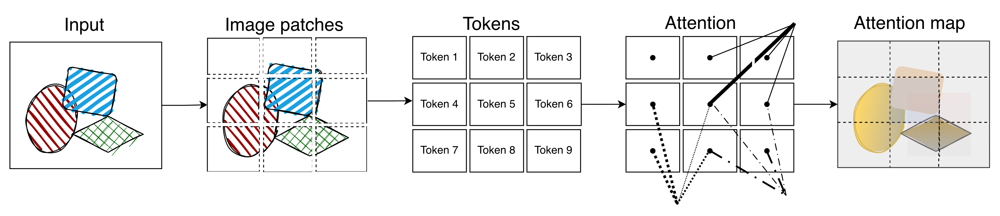

<!--          style="display: block; width: 100%; height: 220px; -->

<!--                 object-fit: contain; object-position: center bottom; margin: 0; cursor: zoom-in" -->

<!--                 onclick="document.getElementById('zoom-image-1').showModal()"> -->

<!--       <dialog id="zoom-image-1" -->

<!--         onclick="this.close()" -->

<!--         style="max-width:95vw; max-height:95vh; padding:0; border:0; -->

<!--                background:transparent; cursor:zoom-out;"> -->

<!--         

<!--           style="display:block; max-width:90vw; max-height:90vh; -->

<!--              width:auto; height:auto;"> -->

<!--     </dialog>            -->

<!--     <figcaption style="margin-top: 4px; font-size: 16px;">ViT Diagram</figcaption> -->

<!--   </figure> -->

<!-- </div> -->

<!-- ``` -->

<!-- ::: {style="position: absolute; right: -14px; bottom: -30px; font-size: 12px; line-height: 1.2; color: #555; text-align: right;"} -->

<!-- Source: @transformer @vit -->

<!-- ::: -->

<!-- ::: {style="position: absolute; left: 20px; bottom: 14px; font-size: 16px;"} -->

<!-- [← Background](#background-menu) -->

<!-- ::: -->

## Hubel and Wiesel Biological Vision Model {#human}

[Background · Human recognition · 1/2]{style="font-size: 0.55em; color: #64748b;"}

<!-- Information flow in a heierachical way -->

Inspiration of a computer vision model [@fukushima1980neocognitron]

::: nonincremental
-   Local features are eventually integrated into information for recognition
:::


{#fig-biological_model width="800px"}

```{=html}
<style>
#fig-biological_model img {
  transform: translate(-180px, -40px);
}
</style>
```
<!-- {#fig-biological_model width="800px" style="transform: translateX(-100px);"} -->

::: {style="position: absolute; right: -14px; bottom: -30px; font-size: 12px; line-height: 1.2; color: #555; text-align: right;"}
Image source: @Hubel1962 @fukushima1980neocognitron @loffler2003local
:::

::: {.fragment style="position: absolute; left: 20px; right: 20px; bottom: 20px; font-size: 40px; text-align: center;"}
But there's more
:::

## Grouping

[Background · Human recognition · 2/2]{style="font-size: 0.55em; color: #64748b;"}

```{=html}
<style>
  .reveal .slides .fragment.focus-left,
  .reveal .slides .fragment.focus-right {
    visibility: visible !important;
    transition: opacity 0.3s ease !important;
  }

  .reveal .slides .fragment.focus-left {
    opacity: 1 !important;
  }

  .reveal .slides .fragment.focus-right {
    opacity: 0.25 !important;
  }

  .reveal .slides .fragment.focus-left.visible {
    opacity: 0.25 !important;
  }

  .reveal .slides .fragment.focus-right.visible {
    opacity: 1 !important;
  }
</style>

<div style="display: grid;
            grid-template-columns: repeat(2, minmax(0, 1fr));
            gap: 28px; height: 480px;">

  <div class="fragment custom focus-left" data-fragment-index="0"
       style="display: flex; flex-direction: column;
              min-width: 0; color: #111;">

    <h3 style="margin: 50 0 12px; font-size: 48px;">
```
Gestalt Principles [@gestalt]

```{=html}
</h3>

    <ul style="margin-top: 0;">
      <li>
```
Illusory contour is not physically present but is filled by the visual system [@kanizsa]

```{=html}
</li>
      
    </ul>

    <figure style="margin: 30px 10px 0; text-align: center;">
```
::: {#fig-kaniza-triangle}
```{=html}
      
```
Kanizsa triangle
:::

```{=html}
      <!-- <figcaption style="margin-top: 6px; font-size: 16px; line-height: 1.2;"> -->
      <!--   Kanizsa triangle -->
      <!-- </figcaption> -->
    </figure>
  </div>

  <div class="fragment custom focus-right" data-fragment-index="0"
       style="display: flex; flex-direction: column;
              min-width: 0; color: #111;">

    <h3 style="margin: 0 0 12px; font-size: 48px;">
      Local and Global
    </h3>

    <ul style="margin-top: 0;">
      <li>
```
Shape discrimination relies on both local curvature information and the global organization of that information [@loffler2003local].

```{=html}
</li>
      
    </ul>

    <figure style="margin: auto 0 0; text-align: center;">
```
::: {#fig-local-global}
```{=html}
      
```
A circle was split into five identical one-cycle segments and arranged in four different ways
:::

```{=html}
      <!-- <figcaption style="margin-top: 6px; font-size: 16px; line-height: 1.2;"> -->
      <!--   A circle was split into five identical one-cycle segments and arranged in four different ways. -->
      <!-- </figcaption> -->
    </figure>
  </div>

</div>
```
::: {style="position: absolute; right: -14px; bottom: -30px; font-size: 12px; line-height: 1.2; color: #555; text-align: right;"}
Image sources: \@@kanizsa @loffler2003local
:::

::: {.fragment style="position: absolute; left: 20px; right: 20px; bottom: 20px; font-size: 40px; text-align: center;"}
<!-- Organizing features by both local and global information,  -->

<!-- Resembles computer vision model -->
:::

::: {style="position: absolute; left: 20px; bottom: 14px; font-size: 16px;"}
[← Background](#background-menu)
:::


<!-- ####################### Project1 ##################################### -->

# [Project 1]{#project1 style="font-size: 92px;"}

Is the object detection network sufficient to automate footwear characteristic identification

## Object Detection Architecture

[Project-1 · 1/8]{style="font-size: 0.55em; color: #64748b;"}

::: nonincremental
-   Frame the footwear characteristic identification problem as an object detection task

-   Object detection architecture: Faster-RCNN [@fasterrcnn]

-   Transfer learning
:::

{#fig-detection}

<!-- ##################### project1 Data ################# -->

## Data

[Project-1 · 2/8]{style="font-size: 0.55em; color: #64748b;"}

```{=html}
<div style="display: grid; grid-template-columns: repeat(2, minmax(0, 1fr));
            column-gap: 98px; row-gap: 150px;">
  <div>
    <h3 style="margin: 0 0 -20px; font-size: 44px; text-align: left;">
```
Annotation

```{=html}
    </h3>
    <ul>
      <li>Bounding box ambiguity</li>
      <ul>
        <li>Location ambiguity</li>
        <li>Size ambiguity</li>
      <ul>
    </ul>
  </div>

  <div>
    <h3 style="margin: 0 0 8px; font-size: 44px; text-align: left;">
    Class
    </h3>
    <ul>
      <li>13 classes</li>
        <ul>
        <li>Class ambiguity: class definitions overlap</li>
        <li>Imbalance class distribution</li>
      <ul>
    </ul>
  </div>


<style>
  .annotation-stack img {
    display: block;
    width: 100%;
    height: 200px;
    max-width: none;
    max-height: none;
    object-fit: contain;
    margin: 0;
  }

  .annotation-stack summary {
    display: block;
    list-style: none;
    cursor: pointer;
  }

  .annotation-stack summary::-webkit-details-marker {
    display: none;
  }

  .annotation-stack details[open] > summary {
    display: none;
  }
</style>

<div class="annotation-stack" style="margin: -220px; text-align: center;">
<div style="display: grid; grid-template-columns: 1fr; gap: 10px;">
```


<!--  -->

```{=html}
<details>
<summary>
```
::: {#fig-annotation-conversion}


Annotation example
:::

```{=html}
</summary>


</details>
</div>
</div>
<!-- <figure class="annotation-stack" style="margin: -140px; text-align: center;"> -->
<!--   <div style="display: grid; grid-template-columns: 1fr; gap: 10px;"> -->

<!--      -->

<!--     <details> -->
<!--       <summary> -->
<!--          -->
<!--       </summary> -->
<!--        -->
<!--     </details> -->

<!--   </div> -->

<!--   <figcaption style="margin-top:-40px; font-size: 26px;"> -->
<!--     Annotation examples -->
<!--   </figcaption> -->
<!-- </figure> -->
```
::: {style="position: relative; top: -110px;"}
```{r, echo=FALSE, warning=FALSE, message=FALSE}
#| label: fig-class-distribution
#| fig-cap: "Number of annotations per class"
#| lightbox: true
#| fig-attr: 'style="transform: translateY(-80px);"'

library(ggplot2)
library(tidyverse)

df <- data.frame(
  # class = c(
  #   "quadrilateral", "line", "circle", "logo", "hexagon",
  #   "polygon", "star", "chevron", "ribbon", "bowtie",
  #   "pentagon", "triangle", "heel", "octagon",
  #   "rectangle", "text"
  # ),
  # count = c(
  #   2134, 1692, 2143, 616, 478,
  #   12, 647, 2094, 180, 666,
  #   131, 1154, 2, 10,
  #   4, 2727
  # )
  class = c(
    "quad", "line", "circle", "logo", "hexagon",
     "star", "chevron", "ribbon", "bowtie",
    "pentagon", "triangle", "octagon",
     "text"
  ),
  count = c(
    2146, 1692, 2143, 616, 478,
     647, 2094, 180, 666,
    131, 1154, 10,
    2727
  )
)
df <- df %>% arrange(desc(count))
df %>% 
  ggplot() +
  geom_col(aes(y=reorder(class, count), x=count), fill="steelblue") +
  theme(
    axis.text.y = element_text(size=10),
    plot.title = element_text(size = 18, hjust = 0.5)
  )
# +
#   labs(title = "Number of Annotations per Class",
#        y = "Class")

```
:::

## Experimental Setup

[Project-1 · 3/8]{style="font-size: 0.55em; color: #64748b;"}

A total of 4144 images in COCO style [@coco]

::: nonincremental
-   Data Split
    -   Training set: 70% of the images
    -   Validation set: 20% of the images
    -   Test set: 10% of the images
-   Training
    -   Default Pytorch model [backbone ResNet50 @hyperparameter]
    -   Hyperparameters suggested by Pytorch [@hyperparameter_py]
    -   200 epochs
    -   batch size of 2
:::

## Evaluation Metric

[Project-1 · 4/8]{style="font-size: 0.55em; color: #64748b;"}

Widely used metric

```{=html}
<style>
  .two-bullets {
    display: grid;
    grid-template-columns: 1fr 1fr;
    gap: 50px;
  }

  .reveal .fragment.grey-out {
    visibility: visible !important;
    opacity: 1 !important;
  }

  .reveal .fragment.grey-out.visible,
  .reveal .fragment.grey-out.visible * {
    color: #aaa !important;
  }
</style>

<div class="two-bullets">

  <div class="fragment grey-out" data-fragment-index="0">
    <ul>
      <li>Average Precision</li>
        <ul>
          <li>Box locations, sizes</li>
          <li>predicted classes</li>
        </ul>
        <li>COCO dataset
        <ul>
          <li>37% 80 classes <sup>[1] [2]</li>
          <li>Clearly defined locations and classes</li>
        </ul>
        <li>Our data: 
        <ul>
          <li>3% 13 classes <sup></li>
          <li>Ambiguous annotation</li>
        </ul>
    </ul>
  </div>


  <div class="fragment fade-in" data-fragment-index="0">
    <ul>
      <li>Unambiguity annotation matters</li>
        <ul>
          <li>
```
Localization precision suffers significantly from inaccurate bounding boxes 
<!-- while classification accuracy is less affected  -->
[@refinebboxlocation]

```{=html}
</li>
          <li>
```
When the quality of training data degenerates, the performance of the typical object detectors is severely impaired [@refineclearcategory]

```{=html}
</li>
</ul>
  </div>

</div>
```
<!-- ::: columns -->

<!-- ::: nonincremental -->

<!-- -    -->

<!--     -   \ -->

<!--     -   \  -->

<!--     -    -->

<!--     -    -->

<!-- ::: -->

<!-- ::: {.column width="40%"} -->

<!-- ::: -->

<!-- ::: -->

::: {style="position: absolute; right: -14px; bottom: -30px; font-size: 12px; line-height: 1.2; color: #555; text-align: right;"}
Source: \[1\]@hyperparameter_py \[2\]@coco
:::

## Improper Metric

[Project-1 · 5/8]{style="font-size: 0.55em; color: #64748b;"}

::: nonincremental
::: columns
::: {.column width="50%"}
::: r-stack
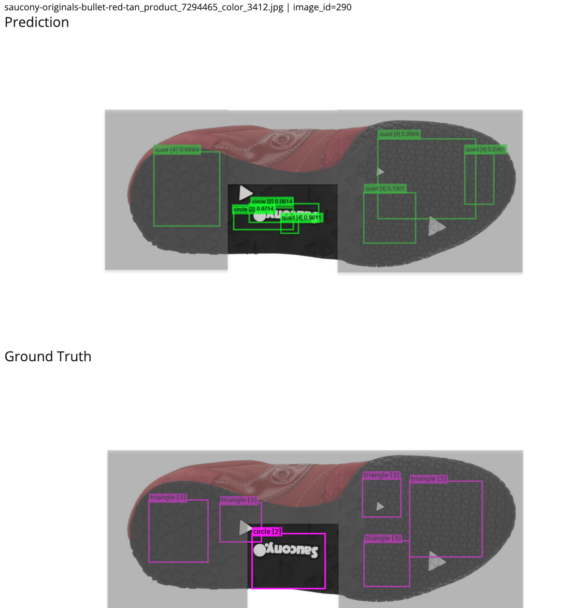{#fig-shiny .fragment .fade-out data-fragment-index="0" height="650px"}

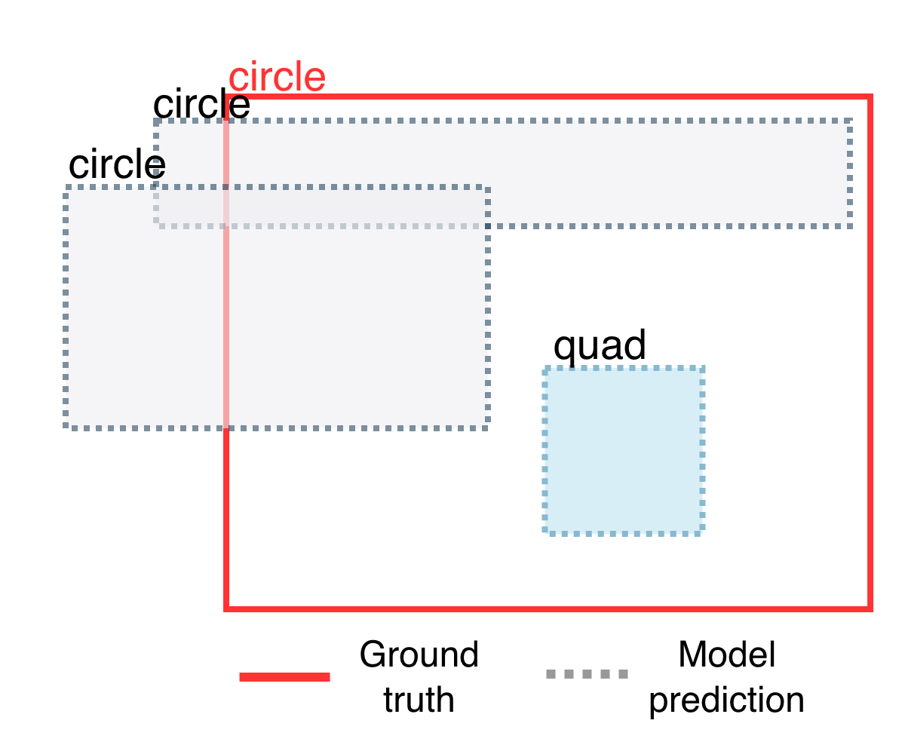{#fig-zoomed .fragment data-fragment-index="0" height="450px"}
:::
:::

::: {.column width="50%"}
-   Annotation ambiguity
    -   box size
    -   box location
-   Taking into account all overlapping bounding boxes
:::
:::
:::

<!-- ::: {.nonincremental} -->

<!-- :::: {.columns} -->

<!-- ::: {.column width="50%"} -->

<!-- {.fragment .fade-out data-fragment-index=0 height=700px} -->

<!-- ::: -->

<!-- ::: {.column width="50%"} -->

<!-- ```{=html} -->

<!-- <style> -->

<!--   .reveal .slides .fragment.focus-left, -->

<!--   .reveal .slides .fragment.focus-right { -->

<!--     visibility: visible !important; -->

<!--     transition: opacity 0.3s ease !important; -->

<!--   } -->

<!--   .reveal .slides .fragment.focus-left { -->

<!--     opacity: 1 !important; -->

<!--   } -->

<!--   .reveal .slides .fragment.focus-right { -->

<!--     opacity: 0.25 !important; -->

<!--   } -->

<!--   .reveal .slides .fragment.focus-left.visible { -->

<!--     opacity: 0.25 !important; -->

<!--   } -->

<!--   .reveal .slides .fragment.focus-right.visible { -->

<!--     opacity: 1 !important; -->

<!--   } -->

<!-- </style> -->

<!-- <div style="display: grid; -->

<!--             grid-template-columns: minmax(0, 2fr) minmax(0, 3fr); -->

<!--             gap: 28px; height: 480px;"> -->

<!--   <div class="fragment custom focus-left" data-fragment-index="0" -->

<!--        style="display: flex; flex-direction: column; -->

<!--               min-width: 0; color: #111;"> -->

<!--     <h3 style="margin: 50 0 12px; font-size: 38px;"> -->

<!-- ``` -->

<!--   Widely used metric -->

<!-- ```{=html}     -->

<!-- </h3> -->

<!--     <ul style="margin-top: 0;"> -->

<!--       <li> -->

<!-- ``` -->

<!-- Average Precision -->

<!-- ```{=html} -->

<!-- </li> -->

<!-- <ul> -->

<!--       <!-- <li>Intersection over Union (IoU) </li> -->

<!--       <li>location </li> -->

<!--       <li> -->

<!--       Predicted class -->

<!-- ``` -->

<!-- <!-- Precision=$\frac{TP}{TP+FP}$ -->

<!-- ```{=html} -->

<!-- </li> -->

<!-- <li>AP[0.50–0.95] on COCO dataset: 37% 80 -->

<!-- classes <sup>1</sup> </li> -->

<!-- <li>AP[0.50–0.95] on our data: 0.03% 13 classes</li> -->

<!-- </ul> -->

<!-- </ul> -->

<!--     <figure style="margin: -100px 10px 0; text-align: center;"> -->

<!--       

<!--            style="display: block; width: 100%; height: 120px; -->

<!--                   object-fit: contain; object-position: center bottom; -->

<!--                   max-width: none; max-height: none; margin: 0;"> -->

<!--       <figcaption style="margin-top: 6px; font-size: 16px; line-height: 1.2;"> -->

<!--         <!-- Kanizsa triangle -->

<!--       </figcaption> -->

<!--     </figure> -->

<!--   </div> -->

<!--   <div class="fragment custom focus-right" data-fragment-index="0" -->

<!--        style="display: flex; flex-direction: column; -->

<!--               min-width: 0; color: #111;"> -->

<!--     <h3 style="margin: 0 0 12px; font-size: 38px;"> -->

<!--       New metric -->

<!--     </h3> -->

<!--     <ul style="margin-top: 0;"> -->

<!--       <li> -->

<!-- ``` -->

<!-- Shape discrimination relies on both local curvature information and the global organization of that information (@loffler2003local). -->

<!-- ```{=html} -->

<!-- </li> -->

<!--       <!-- <li>右侧第二条内容</li> -->

<!--       <!-- <li>右侧第三条内容</li> -->

<!--     </ul> -->

<!--     <figure style="margin: -50 0 0; text-align: center;"> -->

<!--       

<!--            style="display: block; width: 100%; height: 420px;  -->

<!--                   object-fit: contain; object-position: center bottom; -->

<!--                   max-width: none; max-height: none; margin: 0;"> -->

<!--       <figcaption style="margin-top: 6px; font-size: 16px; line-height: 1.2;"> -->

<!--         A circle was split into five identical one-cycle segments and arranged in four different ways. -->

<!--       </figcaption> -->

<!--     </figure> -->

<!--   </div> -->

<!-- </div> -->

<!-- ``` -->

## Improving the Metric

[Project-1 · 6/8]{style="font-size: 0.55em; color: #64748b;"}

::: nonincremental
::: columns
::: {.column width="40%"}
Pixel-wise evaluation

-   Consider all predicted boxes
-   Less strict on localization

{#fig-diagram height="300px"}
:::

::: {.column width="60%"}
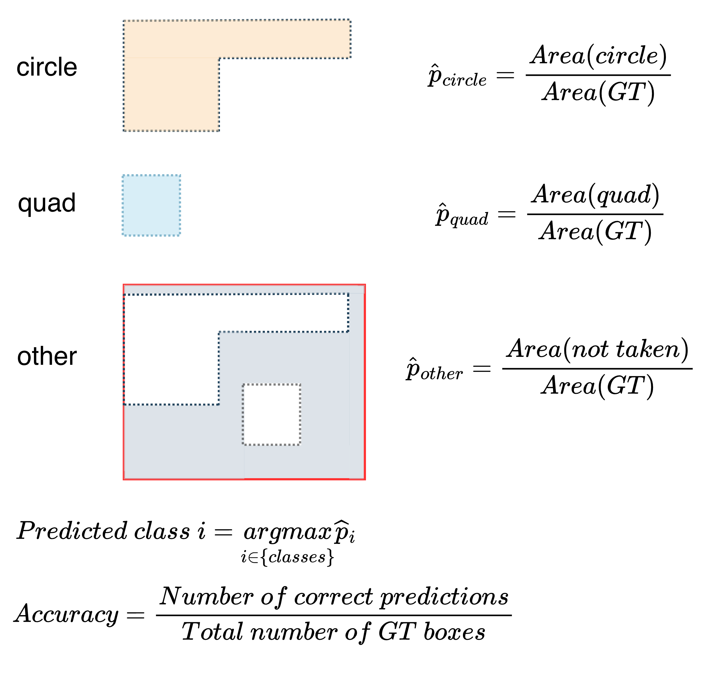{#fig-image height="600px"}
:::
:::
:::

## New Metric Results

[Project-1 · 7/8]{style="font-size: 0.55em; color: #64748b;"}

::: nonincremental
::: columns
::: {.column width="60%"}
-   Improved performance
    -   Accuracy=33%

{#fig-newmetric fig-align="left"}

<!-- ::: -->

<!-- ::: {.column width="60%"} -->

<!-- * What has been addressed:         -->

<!--    * Ambiguous location        -->

<!--    * Ambiguous size -->

<!-- * What has not been addressed: -->

<!--     * Ambiguous classes -->
:::
:::
:::

## Project 1 Summary

[Project-1 · 8/8]{style="font-size: 0.55em; color: #64748b;"}

```{=html}
<style>

.split-demo .image-swap {
  display: grid !important;
  position: relative;
  z-index: 0;
}

.reveal .split-demo .image-swap > img {
  grid-area: 1 / 1 !important;
  width: 100%;
  height: auto;
  margin: 0;
}

.split-demo .image-stage > .grey-mask {
  z-index: 10;
}


  
  .split-demo .left-boxes {
    margin-top: 80px;
  }
  
  
  .split-demo .content-box {
    padding: 24px;
  }
  
  .split-demo {
    --bullet-size: 40px;
    --title-size: 44px;
  }

  .split-demo {
    --bullet-size: 26px; 
    --title-size: 30px;  

    display: grid;
    grid-template-columns: minmax(0, 2fr) minmax(0, 3fr);
    gap: 24px;
    text-align: left;
  }

  
  .split-demo .left-boxes {
    display: flex;
    flex-direction: column;
    gap: 20px;
    min-width: 0;
  }

  .split-demo .content-box {
    border: 2px solid #888;
    border-radius: 12px;
    padding: 16px 20px;
  }

  .reveal .split-demo h3 {
    font-size: var(--title-size);
    margin: 0 0 12px;
  }

  .reveal .split-demo ul {
    display: block;
    margin: 0;
    padding-left: 1.2em;
    font-size: var(--bullet-size);
  }

  .reveal .split-demo li {
    margin-bottom: 10px;
  }

  
  .reveal .split-demo .fragment.grey-later {
    visibility: inherit !important;
    opacity: 1 !important;
  }

  .reveal .split-demo .fragment.grey-later.visible,
  .reveal .split-demo .fragment.grey-later.visible * {
    color: #aaa !important;
  }

  
  .split-demo .right-panel {
    min-width: 0;
  }

  .reveal .split-demo .right-image {
    display: block;
    width: 100%;
    height: auto;
    max-height: 480px;
    object-fit: contain;
    margin: 20px 0 0;
    border: none;
    box-shadow: none;
  }
  
  
  .split-demo .image-stage {
    position: relative;
    width: 80%;
    margin-top: 20px;
    cursor: zoom-in;
  }
  
  .reveal .split-demo .image-stage img {
    display: block;
    width: 100%;
    height: auto;
    max-height: none;
    margin: 0;
  }
  
  
  .image-stage .grey-mask {
    position: absolute;
    left: 0%;
    top: 0%;
    width: 60%;
    height: 100%;
    background: rgba(170, 170, 170, 0.7);
    pointer-events: none;
  }
  
  
  .masked-image-dialog {
    padding: 0;
    border: none;
    background: transparent;
    max-width: 94vw;
    max-height: 94vh;
  }
  
  .masked-image-dialog::backdrop {
    background: rgba(0, 0, 0, 0.75);
  }
  
  .masked-image-dialog .image-stage {
    position: relative;
    margin: 0;
    cursor: zoom-out;
  }
  
  .masked-image-dialog img {
    display: block;
    width: auto;
    height: auto;
    max-width: 90vw;
    max-height: 85vh;
    margin: 0;
  }
</style>

<div class="split-demo">

  <div class="left-boxes">

    
    <div class="content-box fragment fade-in"
         data-fragment-index="0">
      <h3> Ambiguity </h3>

      <ul >
        <li class="fragment grey-later"
            data-fragment-index="1">
          Box location
        </li>

        <li class="fragment grey-later"
            data-fragment-index="1">
          Box size
        </li>

        <li>
          Class
        </li>
      </ul>
    </div>

    
    <div class="content-box fragment fade-in"
         data-fragment-index="1">
      <h3>Implementing a new metric</h3>

      <ul>
        <li>Resolve the box ambiguity</li>
        <li>Accuracy: 33%
        <!-- , not far from the reported accuracy 37% -->
        </li>
        <li>Class ambiguity has not been considered </li>
      </ul>
    </div>

  </div>

    
  
```
::: {#fig-quad .fragment .fade-in fragment-index="2" fragment-index="2"}
```{=html}
<div class="right-panel">

  <ul>
    <li>Revisit the result </li>
  </ul>


  <div class="image-stage"
       role="button"
       tabindex="0"
       aria-label="zoom in"
       onclick="
         event.stopPropagation();
         const replacement = this.querySelector('.replacement-image');
         const current = replacement.classList.contains('visible')
           ? replacement
           : this.querySelector('.original-image');
         const popup = document.getElementById('swap-preview');
         popup.querySelector('img').src = current.src;
         popup.showModal();
       "
       onkeydown="
         if (event.key === 'Enter' || event.key === ' ') {
           event.preventDefault();
           event.stopPropagation();
           this.click();
         }
       ">
       
    <div class="image-swap">
      
      
  </div>

<div class="grey-mask"></div>
  </div>
</div>
```
Quad and triangle
:::

```{=html}
    

    
    

<dialog id="swap-preview"
        class="masked-image-dialog"
        aria-label=""
        onclick="event.stopPropagation(); this.close();">

  <div class="image-stage">
    


    <div class="grey-mask"></div>
  </div>
</dialog>


</dialog>
```
<!-- <div class="step-box fragment fade-in" data-fragment-index="0"> -->

<!--     <h3>Step 1</h3> -->

<!--     <p>Ambiguity</p> -->

<!--       <li> -->

```{=html}
<!--         
<!--       </li> -->
```
<!--   </div> -->

<!-- ::: nonincremental -->

<!-- ::: columns -->

<!-- ::: {.column width="40%"} -->

<!-- -   We implemented a new metric -->

<!--     -   Accuracy=0.33 -->

<!--  -->

<!-- ::: -->

<!-- ::: {.column width="60%"} -->

<!-- * Revisit the result   -->

<!-- {height="600px"} -->

<!-- ::: -->

<!-- ::: -->

<!-- ::: -->

# [Project 2 and Project 3]{style="font-size: 92px;"}

How well do neural networks perform on shape generalization tasks

## Follow-up Questions

[Project 2 and Project 3 · 1/3]{style="font-size: 0.55em; color: #64748b;"}

::: columns
::: {.column width="50%"}
::: nonincremental
-   **Project 2**

    -   How do networks with different backbones perform on geometric shape classification?

    -   Are these networks biased toward certain geometric shapes?

    -   How do the activation patterns differ between the networks in classification?
:::
:::

::: {.column width="50%"}
::: nonincremental
-   **Project 3**

    -   Which factors affect the network’s classification decisions
        -   Number of sides
        -   Side length
        -   Interior angles
:::
:::
:::

## Experimental Study Design

[Project 2 and Project 3 · 2/3]{style="font-size: 0.55em; color: #64748b;"}

```{=html}
<style>
  .bullet-photo-layout {
    display: grid;
    grid-template-columns: minmax(0, 60fr) minmax(0, 40fr);
    gap: 30px;
    text-align: left;
  }

  .reveal .bullet-photo-layout ul {
    display: block;
    margin: 0;
    padding-left: 1.2em;
    font-size: 30px; /* bullet 字号 */
  }

  .bullet-photo-layout li {
    margin-bottom: 15px;
  }

  .bullet-photo-layout .photo-column {
    display: flex;
    flex-direction: column;
    gap: 15px;
    min-width: 0;
  }

  .reveal .bullet-photo-layout .photo-column img {
    display: block;
    width: 100%;
    height: auto; /* 每张图片占据的高度 */
    object-fit: contain;
    margin: 0;
    border: none;
    box-shadow: none;
  }
</style>

<div class="bullet-photo-layout">

  <!-- 左侧 bullet -->
  <div>
    <ul>
      <li class="fragment fade-in" data-fragment-index="0">
        Select architectures that were state-of-the-art at the time
      </li>

      <li class="fragment fade-in" data-fragment-index="1">
        Design tests using geometric shapes for both the training and test sets
        <ul>
          <li class="fragment fade-in" data-fragment-index="1">
          Train networks on the training data
          and evaluate on test sets
          </li>
          <li class="fragment fade-in" data-fragment-index="2">
          Test sets
          </li>
            <ul>
              </li>
                <li class="fragment fade-in" data-fragment-index="2">
                Seen test set
              </li>
                <li class="fragment fade-in" data-fragment-index="3">
                Challenging test test
              </li>
            </ul>
            
          <li class="fragment fade-in" data-fragment-index="4">
          Evaluation
          </li>
            <ul>
              </li>
                <li class="fragment fade-in" data-fragment-index="4">
                Classification accuracy - architecture bias
              </li>
                <li class="fragment fade-in" data-fragment-index="4">
                Feature map - activation correlation
              </li>
              </li>
                <li class="fragment fade-in" data-fragment-index="4">
                Classification outcome - correct or incorrect - Binomial generalized linear model (GLM)
              </li>
            </ul>
        </ul>
      </li>

      <!-- <li class="fragment fade-in" data-fragment-index="2"> -->
      <!--   Third point -->
      <!-- </li> -->
    </ul>
  </div>

  <!-- 右侧图片竖排 -->
  <div class="photo-column">
    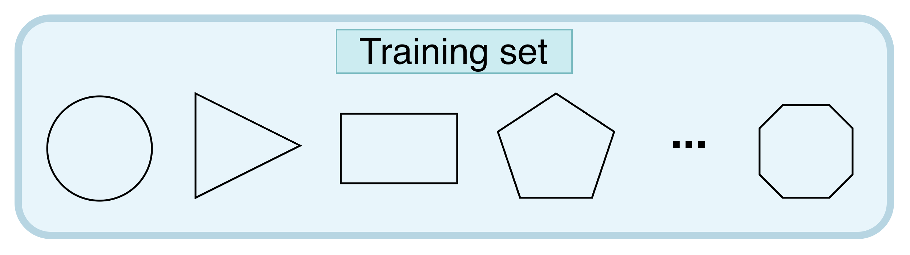

    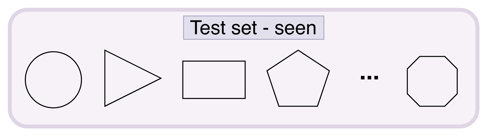

    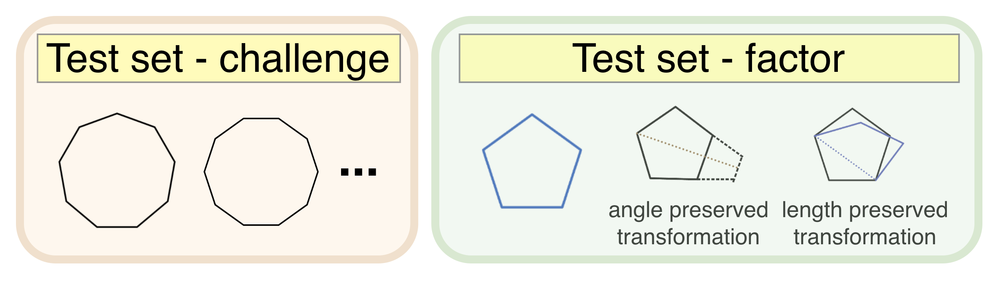
```
::: {#fig-test_all .fragment .fade-in fragment-index="4"}
```{=html}
    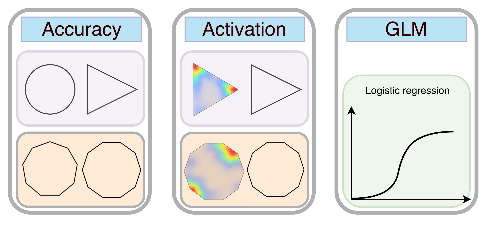
```
Experimental design diagram
:::

```{=html}
</div>

</div>
```
## Summary - Project 2 and Project 3

[Project 2 and Project 3 · 3/3]{style="font-size: 0.55em; color: #64748b;"}

::: {.fragment .nonincremental fragment-index="0"}
Investigate neural networks’ performance on shape generalization tasks

-   Explore whether neural networks can learn abstract shape representation

-   Identify the factors that impact the decisions of neural networks in polygon classification tasks using statistical study

-   Provide recommended architecture for geometric related tasks
:::

::: {.fragment .nonincremental fragment-index="1" style="margin-top: -10px;"}
-   **Progress**
:::

::: {.fragment .nonincremental fragment-index="2" style="margin-top: -30px; font-size: 28px; position: relative; left: 40px;"}
::: columns
::: {.column width="50%"}
**Project 2 progress**

-   [✓]{style="color: green;"} Literature review
-   [✓]{style="color: green;"} Design
-   [✓]{style="color: green;"} Data simulation
-   [✓]{style="color: green;"} Experiment
-   [◷]{style="color: #e69500;"} Analysis
-   Write-up
:::

::: {.column width="50%"}
**Project 3 progress**

-   [✓]{style="color: green;"} Literature review
-   [✓]{style="color: green;"} Design
-   [✓]{style="color: green;"} Data simulation
-   [◷]{style="color: #e69500;"} Experiment
-   Analysis
-   Write-up
:::
:::
:::

# [Questions and comments]{style="font-size: 92px;"}

# Reference {.allowframebreaks}

::: {#refs}
:::


<!-- # Average precision {visibility="uncounted"} -->

<!-- 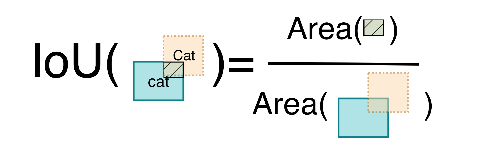 -->

<!-- # Appendix -->

<!-- 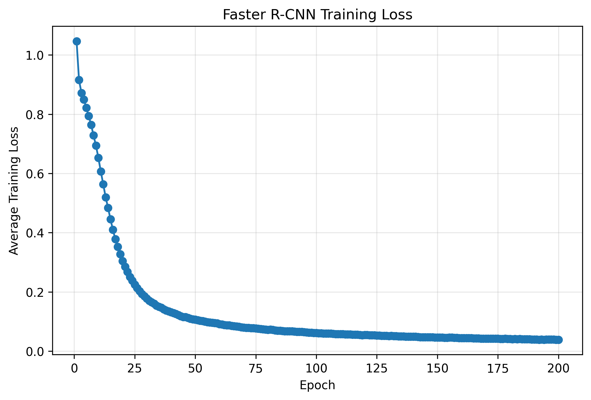 -->
