# Outline

<!-- {style="font-size: 132px;"} -->

::: nonincremental
-   Motivation

-   Background

-   Preliminary result

    -   Object detection network performance in identifying footwear characteristics

-   Moving forward <!-- * Classification network performance on challenging geometric patterns --> <!-- * Factors influencing polygon classification by neural networks -->

-   Questions
:::

# [Motivation]{style="font-size: 132px;"}

<!-- ############################## page4 ####################### -->

## Forensic Footwear Evidence

[Motivation · 1/4]{style="font-size: 0.55em; color: #64748b;"}

::: notes
:::

::: columns
**Class Characteristic** can provide association between a suspect and the scene [@hammer2018footwear]

::: {.column width="45%"}
-   Outsole design

-   Manufactured features

-   Physical sizes
:::

```{=html}
<style>
  .reveal .compact-figures figure {
    margin: 0;
  }

  .reveal .compact-figures figcaption {
    font-size: 12px;
    line-height: 1.2;
    margin: 4px 0 0;
  }
</style>
```
::: {.column width="55%"}
<!-- **Class Characteristic** can provide association between a suspect and the scene [@hammer2018footwear] -->

<!-- ::: incremental -->

<!-- -   Outsole design -->

<!-- -   Manufactured features -->

<!-- -   physical sizes -->

<!-- ::: -->

<!-- ::: {#fig-characteristics layout-ncol="2"} -->

<!-- ::: {.compact-figures layout-ncol=1 style="background: #f1f3f5; padding: 6px 12px; border-radius: 10px;"} -->

::: {.compact-figures layout-ncol="1" style="margin-top: -30px;; padding: 6px 12px; border-radius: 10px;"}
![Outsole of a <!-- [ --> Adidas adipure Golf Shoes<sup>\[1\]</sup> <!-- ] --> <!-- (https://www.nike.com/w/zoom-air-shoes-8y8c6zy7ok) -->](images/feature.jpg){#fig-design .lightbox fig-align="center" height="200px"}

![Specific outsole design differences across sizes within the same general tread design <sup>\[2\]</sup>](images/chracter.png){#fig-sizes .lightbox fig-align="center" height="200px"}

<!-- ::: -->
:::
:::
:::

::: {style="position: absolute; right: -14px; bottom: -30px; font-size: 12px; line-height: 1.2; color: #555; text-align: right;"}
Image sources: 1 @Adipure <br> 2 @hammer2018footwear
:::

<!-- ##########################3####### New Slide ######################## -->

## Frequency Study

[Motivation · 2/4]{style="font-size: 0.55em; color: #64748b;"}

Link the scenes at the local level

<!-- :::: {.fragment data-fragment-index="0"} -->

<!-- ::: incremental -->

<!-- -   How often a design may occur in a population -->

<!-- -   How often a random accidental characteristic is likely to repeat -->

<!-- ::: -->

<!-- :::: -->

<ul>

<li class="fragment" data-fragment-index="0">

How often a design may occur in a population

</li>

<li class="fragment" data-fragment-index="1">

How often a random accidental characteristic is likely to repeat

</li>

<li class="fragment" data-fragment-index="2">

Use pattern descriptions to characterize the types of shoes worn by a population <!-- $\hat{p}=\frac{}{}$  -->

</li>

<!-- <li class="fragment" data-fragment-index="2"> Estimate the distribution of classes $\hat{p}=\frac{}{}$ </li> -->

</ul>

<!-- Who is examining the evidence? -->

<!-- <ul> -->

<!--   <!-- <li class="fragment" data-fragment-index="3"> Collect footwear evidence from the scene </li> -->

<!--   <li class="fragment" data-fragment-index="4"> Examiners evaluate the evidence and interpret the features</li> -->

<!-- </ul> -->

<!-- #####################################？？？？？something new!!!! -->

<!-- ```{=html} -->

<!-- <style> -->

<!--   .reveal .center-captions figcaption { -->

<!--     text-align: center; -->

<!--   } -->

<!-- </style> -->

<!-- ``` -->

<!-- :::: {.center-captions layout-ncol=2 layout-valign="top" style="background: #f1f3f5; padding: 16px; border-radius: 10px; margin-top: -52px;"} -->

<!-- ::: {.fragment data-fragment-index="3"} -->

<!-- {height=200px fig-align="center"} -->

<!-- ::: -->

<!-- ::: {.fragment data-fragment-index="4"} -->

<!-- {height=200px fig-align="center"} -->

<!-- ::: -->

<!-- :::: -->

<!-- ################################# PAGE 6 ######################## -->

## Local Level

[Motivation · 3/4]{style="font-size: 0.55em; color: #64748b;"}

::: columns
::: {.column width="60%"}
```{=html}
<ul>
  <li class="fragment" data-fragment-index="0">
    There is a large volume of data
    <ul>
      <li>Data needs to be collected from local residents</li>
      <li>Automating the data processing is required</li>
    </ul>
  </li>
  <li class="fragment" data-fragment-index="1">
    The examiners evaluate evidence in the way humans do
    <ul>
      <li>The automated process needs to align with human judgement</li>
    </ul>
  </li>
</ul>
```
:::

::: {.column width="40%"}
::: {.fragment data-fragment-index="0" style="background: #ffffff; border-radius: 10px; padding: 46px;"}
{#fig-scanner width="100%" fig-alt="Collect" style="height: 600px; object-fit: contain;"}
:::
:::
:::

<!-- ##################### PAGE 7 ################################3 -->

## Tentative Solution

[Motivation · 4/4]{style="font-size: 0.55em; color: #64748b;"}

::: columns
::: {.column width="60%"}
```{=html}
<ul>
  <li>Neural network-based vision model
    <ul>
      <li class="fragment" data-fragment-index="0">
        Localize patterns
      </li>
      <li class="fragment" data-fragment-index="1">
        Classify the pattern within the detected bounding box
      </li>
    </ul>
  </li>
</ul>
```
:::

::: {.column width="40%"}
::: {#fig-pattern}
```{=html}
<div style="position:relative;">
  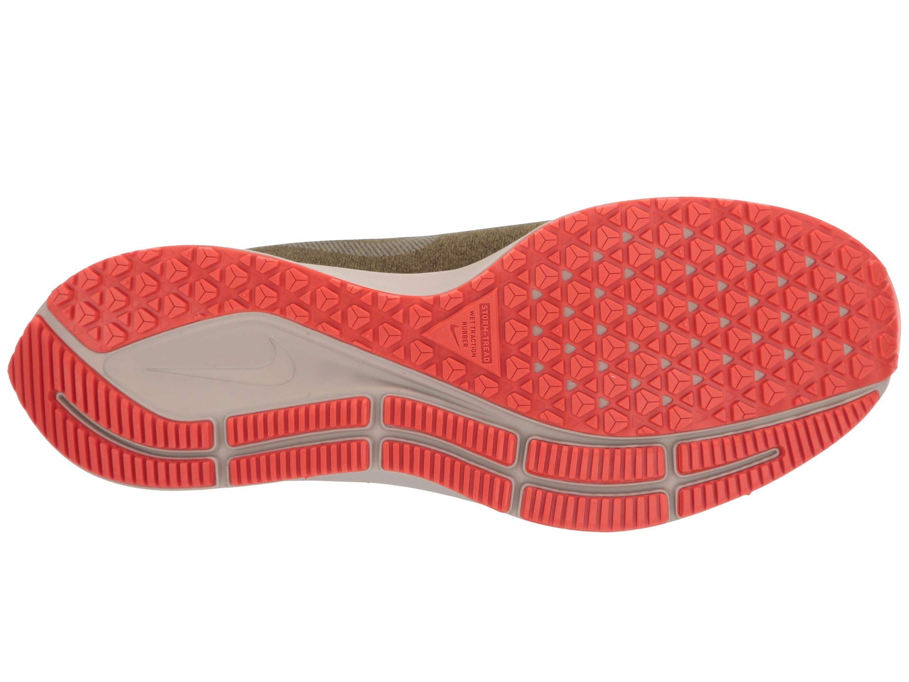

  <div style="position:absolute; left:42%; top:40%; width:13%; height:17%;">
    <div class="fragment" data-fragment-index="0"
         style="position:absolute; inset:0; border:4px solid #FFFFFF; box-sizing:border-box;">
    </div>

    <div class="fragment" data-fragment-index="1"
         style="position:absolute; bottom:100%; left:0; background:#FFFFFF; color:black; padding:3px 8px; font-size:0.55em; white-space:nowrap;">
      triangle
    </div>
  </div>
</div>
```
Pattern localization and classification.
:::
:::
:::

<!-- ######################## PAGE 9 ############################# -->

# [Background]{style="font-size: 132px;"}

## The Pieces {#background-menu}

[Background · 1/2]{style="font-size: 0.55em; color: #64748b;"}

::: nonincremental
-   Automating the process: [neural networks](#nn)

-   Human making judgement: [human recognition](#human)

-   Do vision models recognize shapes the way humans do? <!-- (#nnhuman) -->

-   The coding of shoesoles is ambiguous
:::

::: {layout-ncol="1" layout-valign="top"}
<!--  -->

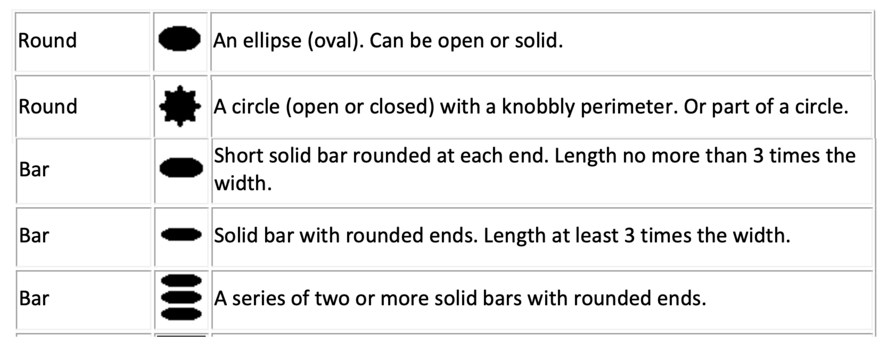{#fig-solemate height="300px"}
:::

## Research Objectives {#background-menu}

[Background · 2/2]{style="font-size: 0.55em; color: #64748b;"}

Do vision models recognize shapes the way humans do?

-   Neural network performance in identifying footwear characteristics
-   Network performance on challenging geometric patterns
-   Factors influencing neural network predictions

<!-- ####################### Project1 ##################################### -->

# [Project 1]{style="font-size: 132px;"}

Is the object detection network sufficient to automate footwear characteristic identification

## Object Detection Architecture

[Project-1 · 1/7]{style="font-size: 0.55em; color: #64748b;"}

::: nonincremental
-   Frame the footwear characteristic identification problem as an object detection task

-   Object detection architecture (Faster-RCNN, @fasterrcnn)

-   Transfer learning
:::

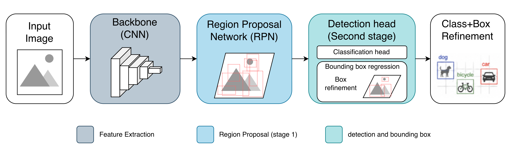{#fig-detection}

<!-- ##################### project1 Data ################# -->

## Data

[Project-1 · 2/7]{style="font-size: 0.55em; color: #64748b;"}

```{=html}
<div style="display: grid; grid-template-columns: repeat(2, minmax(0, 1fr));
            column-gap: 98px; row-gap: 150px;">
  <div>
    <h3 style="margin: 0 0 8px; font-size: 44px; text-align: left;">
```
Annotation

```{=html}
    </h3>
    <ul>
      <li>Bounding boxes</li>
      <ul>
        <li>Duplicate labels and boxes</li>
        <li>Polygons to boxes</li>
      <ul>
    </ul>
  </div>

  <div>
    <h3 style="margin: 0 0 8px; font-size: 44px; text-align: left;">
    Class
    </h3>
    <ul>
      <li>13 classes</li>
        <ul>
        <li>Class ambiguity</li>
        <li>Imbalance class distribution</li>
      <ul>
    </ul>
  </div>


<style>
  .annotation-stack img {
    display: block;
    width: 100%;
    height: 200px;
    max-width: none;
    max-height: none;
    object-fit: contain;
    margin: 0;
  }

  .annotation-stack summary {
    display: block;
    list-style: none;
    cursor: pointer;
  }

  .annotation-stack summary::-webkit-details-marker {
    display: none;
  }

  .annotation-stack details[open] > summary {
    display: none;
  }
</style>

<figure class="annotation-stack" style="margin: -140px; text-align: center;">
  <div style="display: grid; grid-template-columns: 1fr; gap: 10px;">

    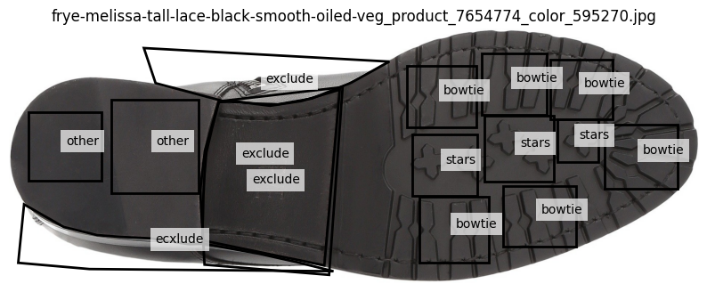

    <details>
      <summary>
        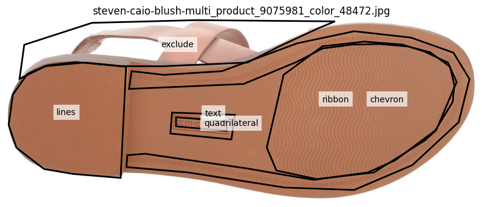
      </summary>
      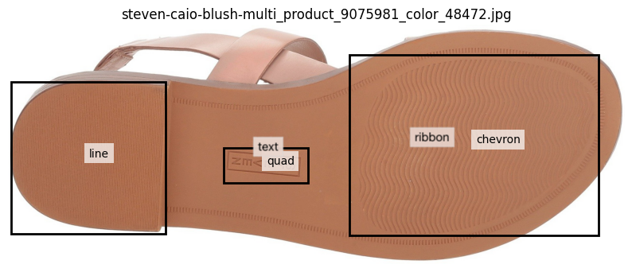
    </details>

  </div>

  <figcaption style="margin-top:-40px; font-size: 26px;">
    Annotation examples
  </figcaption>
</figure>
```
::: {style="position: relative; top: -80px;"}
```{r, echo=FALSE, warning=FALSE, message=FALSE}
#| label: fig-class-distribution
#| fig-cap: "Number of annotations per class"
#| lightbox: true
#| fig-attr: 'style="transform: translateY(-80px);"'

library(ggplot2)
library(tidyverse)

df <- data.frame(
  # class = c(
  #   "quadrilateral", "line", "circle", "logo", "hexagon",
  #   "polygon", "star", "chevron", "ribbon", "bowtie",
  #   "pentagon", "triangle", "heel", "octagon",
  #   "rectangle", "text"
  # ),
  # count = c(
  #   2134, 1692, 2143, 616, 478,
  #   12, 647, 2094, 180, 666,
  #   131, 1154, 2, 10,
  #   4, 2727
  # )
  class = c(
    "quad", "line", "circle", "logo", "hexagon",
     "star", "chevron", "ribbon", "bowtie",
    "pentagon", "triangle", "octagon",
     "text"
  ),
  count = c(
    2146, 1692, 2143, 616, 478,
     647, 2094, 180, 666,
    131, 1154, 10,
    2727
  )
)
df <- df %>% arrange(desc(count))
df %>% 
  ggplot() +
  geom_col(aes(y=reorder(class, count), x=count), fill="steelblue") +
  theme(
    axis.text.y = element_text(size=10),
    plot.title = element_text(size = 18, hjust = 0.5)
  )+
  labs(title = "Number of Annotations per Class",
       y = "Class")

```
:::

## Experimental Setup

[Project-1 · 3/7]{style="font-size: 0.55em; color: #64748b;"}

A total of 4144 images in COCO style (@coco)

::: nonincremental
-   Data Split
    -   Training set: 70% of the images
    -   Validation set: 20% of the images
    -   Test set: 10% of the images
-   Training
    -   Default Pytorch model (backbone ResNet50 @hyperparameter)
    -   Hyperparameters suggested by Pytorch (@hyperparameter_py))
    -   200 epochs
    -   batch size of 2
:::

## Evaluation Metric

[Project-1 · 4/7]{style="font-size: 0.55em; color: #64748b;"}

Widely used metric

::: columns
::: {.column width="60%"}
::: nonincremental
-   Average Precision

    -   Box locations\
    -   predicted classes\
    -   AP\[0.50–0.95\] on COCO dataset: 37% 80 classes ^\[1\]^
    -   AP\[0.50–0.95\] on our data: 0.03% 13 classes
:::
:::

::: {.column width="40%"}
:::
:::

::: {style="position: absolute; right: -14px; bottom: -30px; font-size: 12px; line-height: 1.2; color: #555; text-align: right;"}
Source: <sup>\[1\]</sup>@hyperparameter_py
:::

## Improper Metric

[Project-1 · 5/7]{style="font-size: 0.55em; color: #64748b;"}

::: nonincremental
::: columns
::: {.column width="50%"}
::: r-stack
caption does not follow image change

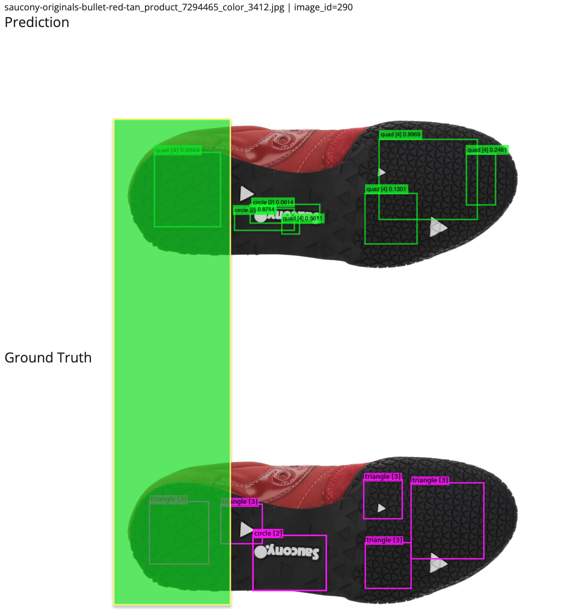{.fragment .fade-out data-fragment-index="0" height="700px"}

{.fragment data-fragment-index="0" height="450px"}
:::
:::

::: {.column width="50%"}
-   Annotation ambiguity in location

-   Taking into account all overlapping bounding boxes
:::
:::
:::

<!-- ::: {.nonincremental} -->

<!-- :::: {.columns} -->

<!-- ::: {.column width="50%"} -->

<!-- {.fragment .fade-out data-fragment-index=0 height=700px} -->

<!-- ::: -->

<!-- ::: {.column width="50%"} -->

<!-- ```{=html} -->

<!-- <style> -->

<!--   .reveal .slides .fragment.focus-left, -->

<!--   .reveal .slides .fragment.focus-right { -->

<!--     visibility: visible !important; -->

<!--     transition: opacity 0.3s ease !important; -->

<!--   } -->

<!--   .reveal .slides .fragment.focus-left { -->

<!--     opacity: 1 !important; -->

<!--   } -->

<!--   .reveal .slides .fragment.focus-right { -->

<!--     opacity: 0.25 !important; -->

<!--   } -->

<!--   .reveal .slides .fragment.focus-left.visible { -->

<!--     opacity: 0.25 !important; -->

<!--   } -->

<!--   .reveal .slides .fragment.focus-right.visible { -->

<!--     opacity: 1 !important; -->

<!--   } -->

<!-- </style> -->

<!-- <div style="display: grid; -->

<!--             grid-template-columns: minmax(0, 2fr) minmax(0, 3fr); -->

<!--             gap: 28px; height: 480px;"> -->

<!--   <div class="fragment custom focus-left" data-fragment-index="0" -->

<!--        style="display: flex; flex-direction: column; -->

<!--               min-width: 0; color: #111;"> -->

<!--     <h3 style="margin: 50 0 12px; font-size: 38px;"> -->

<!-- ``` -->

<!--   Widely used metric -->

<!-- ```{=html}     -->

<!-- </h3> -->

<!--     <ul style="margin-top: 0;"> -->

<!--       <li> -->

<!-- ``` -->

<!-- Average Precision -->

<!-- ```{=html} -->

<!-- </li> -->

<!-- <ul> -->

<!--       <!-- <li>Intersection over Union (IoU) </li> -->

<!--       <li>location </li> -->

<!--       <li> -->

<!--       Predicted class -->

<!-- ``` -->

<!-- <!-- Precision=$\frac{TP}{TP+FP}$ -->

<!-- ```{=html} -->

<!-- </li> -->

<!-- <li>AP[0.50–0.95] on COCO dataset: 37% 80 -->

<!-- classes <sup>1</sup> </li> -->

<!-- <li>AP[0.50–0.95] on our data: 0.03% 13 classes</li> -->

<!-- </ul> -->

<!-- </ul> -->

<!--     <figure style="margin: -100px 10px 0; text-align: center;"> -->

<!--       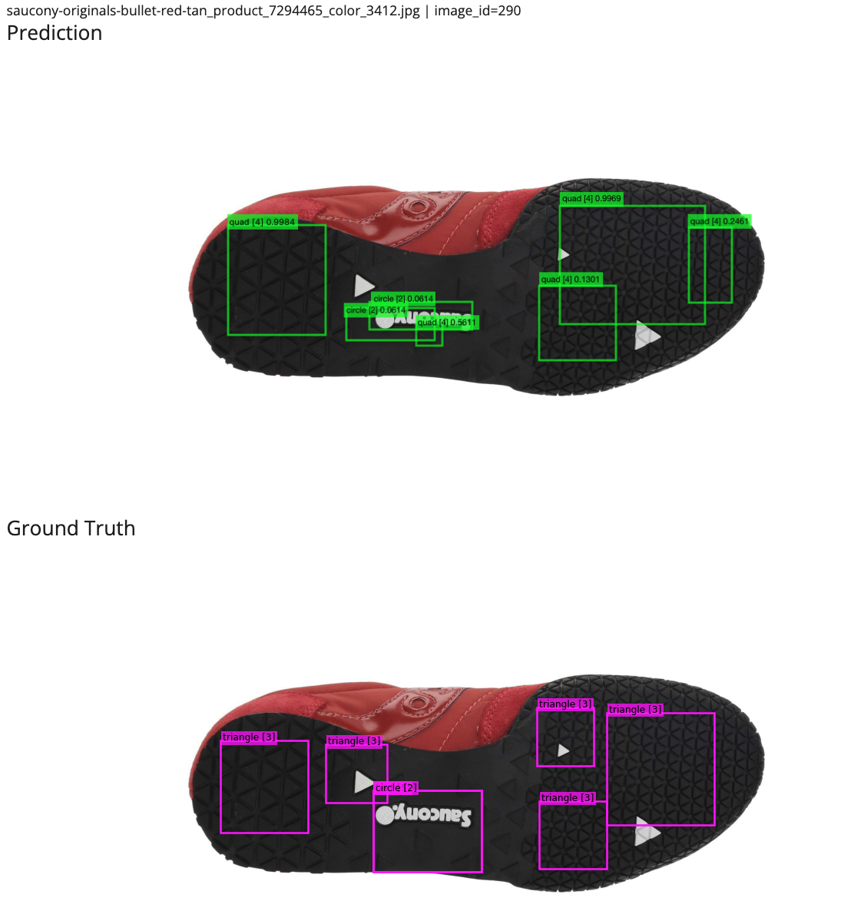

<!--            style="display: block; width: 100%; height: 120px; -->

<!--                   object-fit: contain; object-position: center bottom; -->

<!--                   max-width: none; max-height: none; margin: 0;"> -->

<!--       <figcaption style="margin-top: 6px; font-size: 16px; line-height: 1.2;"> -->

<!--         <!-- Kanizsa triangle -->

<!--       </figcaption> -->

<!--     </figure> -->

<!--   </div> -->

<!--   <div class="fragment custom focus-right" data-fragment-index="0" -->

<!--        style="display: flex; flex-direction: column; -->

<!--               min-width: 0; color: #111;"> -->

<!--     <h3 style="margin: 0 0 12px; font-size: 38px;"> -->

<!--       New metric -->

<!--     </h3> -->

<!--     <ul style="margin-top: 0;"> -->

<!--       <li> -->

<!-- ``` -->

<!-- Shape discrimination relies on both local curvature information and the global organization of that information (@loffler2003local). -->

<!-- ```{=html} -->

<!-- </li> -->

<!--       <!-- <li>右侧第二条内容</li> -->

<!--       <!-- <li>右侧第三条内容</li> -->

<!--     </ul> -->

<!--     <figure style="margin: -50 0 0; text-align: center;"> -->

<!--       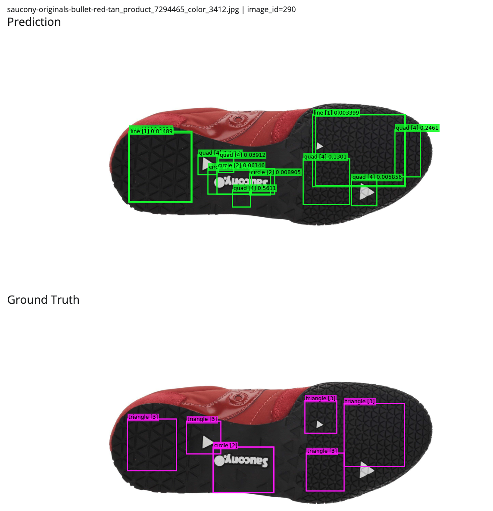

<!--            style="display: block; width: 100%; height: 420px;  -->

<!--                   object-fit: contain; object-position: center bottom; -->

<!--                   max-width: none; max-height: none; margin: 0;"> -->

<!--       <figcaption style="margin-top: 6px; font-size: 16px; line-height: 1.2;"> -->

<!--         A circle was split into five identical one-cycle segments and arranged in four different ways. -->

<!--       </figcaption> -->

<!--     </figure> -->

<!--   </div> -->

<!-- </div> -->

<!-- ``` -->

## Improving the Metric

[Project-1 · 6/7]{style="font-size: 0.55em; color: #64748b;"}

::: nonincremental
::: columns
::: {.column width="40%"}
Pixel wise evaluation

-   Consider all prediceted boxes
-   Less strict on localization

{height="300px"}
:::

::: {.column width="60%"}
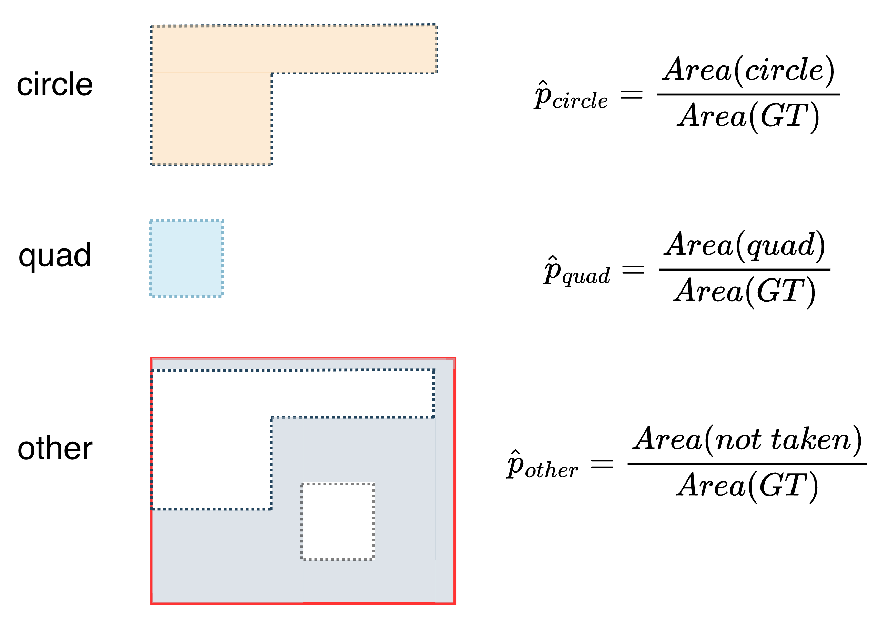{height="500px"}
:::
:::
:::

## New Metric Results

[Project-1 · 7/7]{style="font-size: 0.55em; color: #64748b;"}

::: nonincremental
::: columns
::: {.column width="40%"}
-   Improved performance
    -   Accuracy=0.33

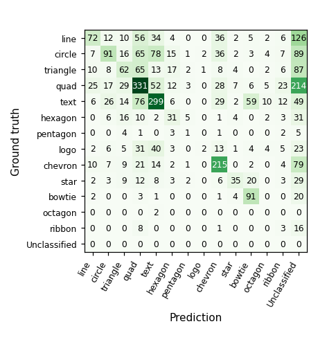
:::

::: {.column width="60%"}
Revisit the output: quad and triangle

{height="600px"}
:::
:::
:::

# [Moving Forward]{style="font-size: 132px;"}

How well do neural networks perform on shape generalization tasks

## Research Questions

[moving forward · 1/2]{style="font-size: 0.55em; color: #64748b;"}

::: nonincremental
-   How do the networks perform on classifying geometric shapes?
-   Are these network architectures biased toward certain geometric shapes?
-   How do the activation patterns differ between the networks during classification??
-   What are the factors impacting the decisions?
:::

## Method

[Moving forward · 2/2]{style="font-size: 0.55em; color: #64748b;"}

::: nonincremental
-   Select representative networks\
-   Train the networks with the same training data and test with different test sets
-   Evaluation and analysis
    -   Accuracy
    -   Activation correlation
    -   Generalized linear model, binomial distribution
:::

::: {layout-ncol="3" layout-valign="top"}
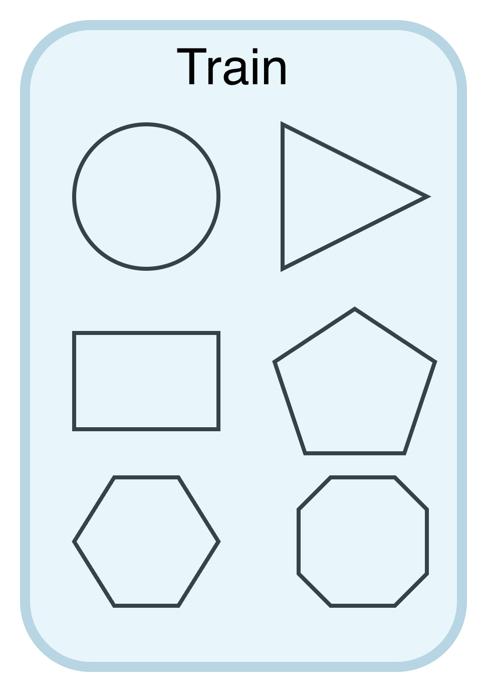{height="200px"}

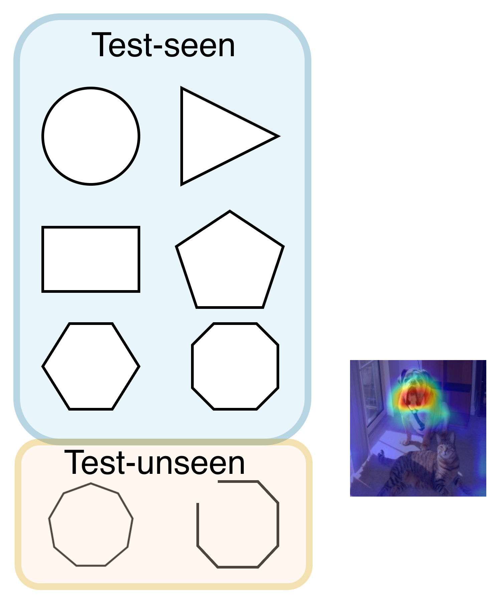{height="200px"}

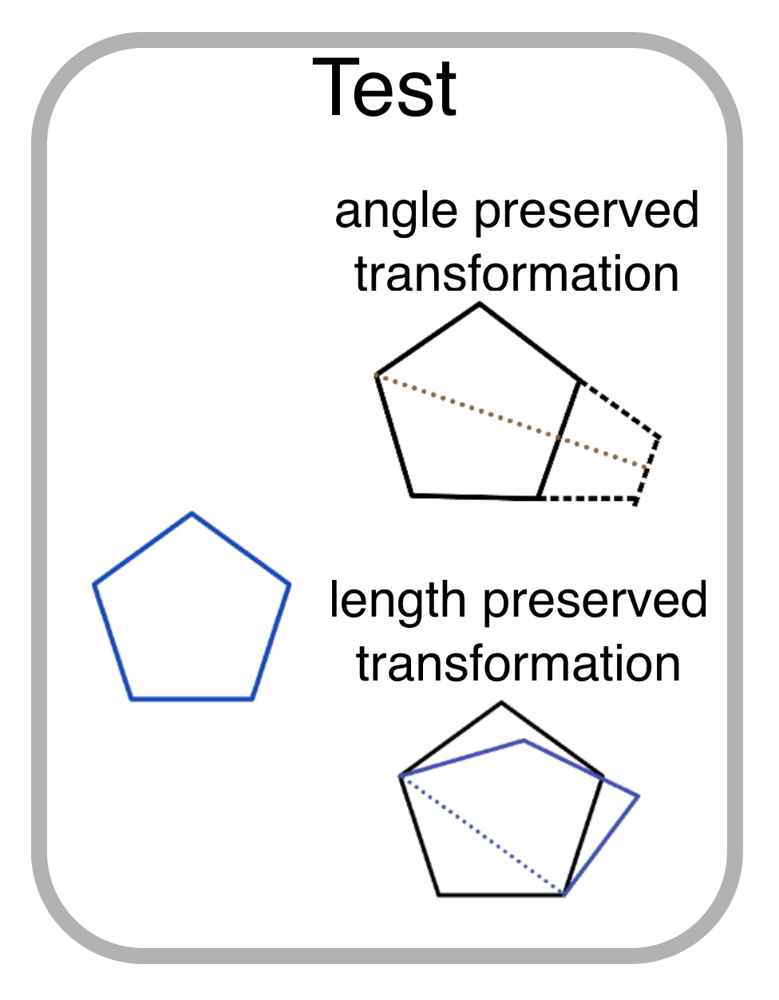{height="200px"}
:::

# [Contribution]{style="font-size: 132px;"}

## Contribution

This is a forensic oriented study, our contributions are as follows:

<!-- * Investigate the gap between computer model and human in shape recognition -->

-   Explore whether neural networks can learn abstract shape representation.
-   Identify the factors that impact the decisions of neural networks in polygon classification tasks using statistical study.
-   Provide recommended architecture for forensic footwear related tasks.

# [Questions and comments]{style="font-size: 132px;"}

<!-- ######################## PAGE 25 ############################# -->

## Neural Networks Process Images for Various Tasks {#nn}

Train with annotated data to get optimal weights in both the backbone and the head for specific tasks

```{=html}
<style>
  .rac-layout {
    display: grid;
    grid-template-columns: minmax(0, 4fr) minmax(0, 1fr);
    height: 360px;
  }

  .rac-rail {
    position: relative;
  }

  .rac-photo {
    position: absolute;
    left: var(--x);
    top: var(--y);
    width: var(--w);
    height: var(--h);
  }
  .rac-photo-name {
  position: absolute;
  top: -10px;
  left: 10px;
  padding: 2px 6px;
  background: rgba(0, 0, 0, 0.7);
  color: white;
  font-size: 14px;
}

  .rac-photo > img,
  .rac-banner > img {
    display: block;
    width: 100%;
    height: 100%;
    max-width: none;
    max-height: none;
    margin: 0;
    object-fit: contain;
  }

  .rac-box {
    position: absolute;
    left: 30%;
    top: 35%;
    width: 40%;
    height: 30%;
    border: 3px solid #e53935;
    box-sizing: border-box;
  }

  .rac-label {
    position: absolute;
    bottom: 100%;
    right: 0;
    padding: 2px 6px;
    background: black;
    color: white;
    font-size: 13px;
    white-space: nowrap;
  }

  .rac-banner {
  width: 80%;
  height: 400px;
  margin: -300px 0 0;
}
  .rac-banner {
  position: relative;
}

.rac-cover {
  position: absolute;
  z-index: 2;
  background: white;
  pointer-events: none;
}

.rac-photo-source {
  position: absolute;
  top: 356px;
  left: 0;
  width: 100%;
  text-align: center;
  font-size: 14px;
  line-height: 1.2;
  color: #555;
}
</style>

<div class="rac-layout">
  <div>
    <ul>
      <li class="fragment" data-fragment-index="0">Classification</li>
      <li class="fragment" data-fragment-index="1">Object detection</li>
      <!-- <li class="fragment" data-fragment-index="2"> </li> -->
    </ul>
  </div>

  <div class="rac-rail">
    <div class="rac-photo fragment" data-fragment-index="0"
         style="--x: 20%; --y: 50px; --w: 60%; --h: 100px;">
      
      <span class="rac-photo-name">Robin 0.8</span>
    </div>

    <div class="rac-photo fragment" data-fragment-index="0"
         style="--x: 20%; --y: 170px; --w: 60%; --h: 100px;">
      
      <span class="rac-photo-name">Blue Jay 0.05</span>
    </div>

    <div class="rac-photo fragment" data-fragment-index="0"
         style="--x: 20%; --y: 290px; --w: 60%; --h: 115px;">
      
      <span class="rac-photo-name">House finch 0.15</span>
    </div>

    <div class="rac-photo fragment" data-fragment-index="1"
         style="--x: 20%; --y: 410px; --w: 60%; --h: 300px;">
      
      <div class="rac-box" style="left: 28%; top: 30%; width: 20%; height: 15%;">
        <span class="rac-label">House finch</span>
      </div>
      
    
      <div class="rac-box" style="left: 10%; top: 64%; width: 35%; height: 15%;">
        <span class="rac-label">House finch</span>
      </div>
      
       <div class="rac-box" style="left: 38%; top: 43%; width: 20%; height: 8%;">
        <span class="rac-label">House finch</span>
      </div>
      
      <div class="rac-box" style="left: 40%; top: 53%; width: 20%; height: 10%;">
        <span class="rac-label">House finch</span>
      </div>
     
     <div class="rac-box" style="left: 70%; top: 28%; width: 15%; height: 8%;">
        <span class="rac-label">House finch</span>
      </div>
      
    </div>
  </div>
</div>

<div class="rac-banner">
  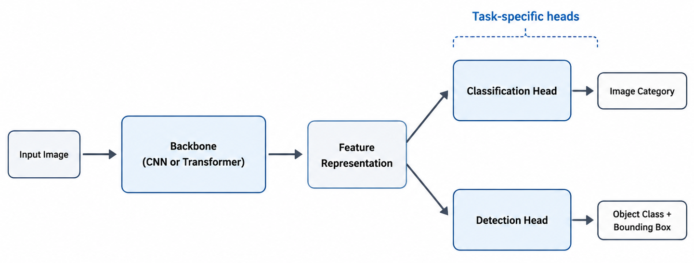

  <div class="rac-cover fragment fade-out" data-fragment-index="0"
       style="left: 58.7%; top: 5%; width: 43%; height: 50%;"></div>

  <div class="rac-cover fragment fade-out" data-fragment-index="1"
       style="left: 58.7%; top: 55%; width: 43%; height: 50%;"></div>
</div>
```
::: {style="position: absolute; right: -14px; bottom: -30px; font-size: 12px; line-height: 1.2; color: #555; text-align: right;"}
Image source: @deng2009imagenet
:::

## Model Training and Transfer Learning

[Background · Neural network · 2/3]{style="font-size: 0.55em; color: #64748b;"}

-   AlexNet 59.3% accuracy [@alexnet]
-   Training from scratch is expensive and requires large training data\
    <!-- * 5–6 days on two NVIDIA GTX 580 GPUs running in parallel, for a total of approximately 240–288 GPU-hours. -->
    -   ImageNet: 1.2 million images, 1000 classes
-   Reuse the backbone
    -   Initializing with transferred <br> features can improve generalization <br> performance [@transfer-learning]

```{=html}
<figure style="position: absolute; right: 10px; bottom: 5px; width: 520px;">
  <div style="position: relative;">
  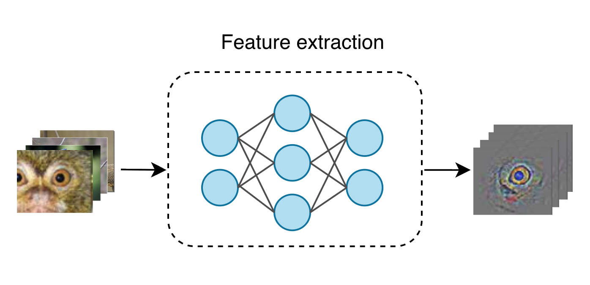
  
  <figcaption style="margin: 2px 0 0; font-size: 16px; line-height: 1.25; text-align: center;">
    A pretrained backbone can be used to extract features
  </figcaption>

  <div style="margin-top: 4px; font-size: 12px; line-height: 1.2; color: #555; text-align: right;">
    <!-- Source: <a href="https://example.com">Author (Year), Fig. 2</a> -->
  </div>
</figure>
```
::: {style="position: absolute; right: -14px; bottom: -30px; font-size: 12px; line-height: 1.2; color: #555; text-align: right;"}
Image source: @abstract
:::

<!-- ```{=html} -->

<!-- <div style="position: absolute; right: 10px; bottom: 5px; width: 620px;"> -->

<!-- Source: <a href="https://example.com">Author (Year), Fig. 2</a> -->

<!--   

<!--        style="display: block; width: 100%; height: auto; max-width: none; max-height: none; margin: 0;"> -->

<!--        <figcaption style="margin-top: 6px; text-align: center; font-size: 16px; line-height: 1.2;"> -->

<!--     A pretrained backbone can be used to extract features [@abstract] -->

<!--   </figcaption> -->

<!-- </div> -->

<!-- ``` -->

<!-- ![A pretrained backbone can be used to extract features [@abstract] ](images/abstract.png) -->

<!-- {.absolute right=-300 bottom=20 width=380} -->

## Two Categories of Vision Models

[Background · Neural network · 3/3]{style="font-size: 0.55em; color: #64748b;"}

```{=html}
<div style="display: grid; grid-template-columns: repeat(2, minmax(0, 1fr));
            column-gap: 98px; row-gap: 150px;">
  <div>
    <h3 style="margin: 0 0 8px; font-size: 44px; text-align: left;">
    Convolutional neural network (CNN)
    </h3>
    <ul>
      <li>Biological inspired hierarchical model</li>
      <li>Local features are integrated into more complex features</li>
      <li>Assumes locality + translation equivariance </li>
    </ul>
  </div>

  <div>
    <h3 style="margin: 0 0 8px; font-size: 44px; text-align: left;">
    Vision Transformer (ViT)
    </h3>
    <ul>
      <li>Modeling globally</li>
      <li>Global context</li>
    </ul>
  </div>

  <figure style="margin: -200px 0 0; text-align: center;">
    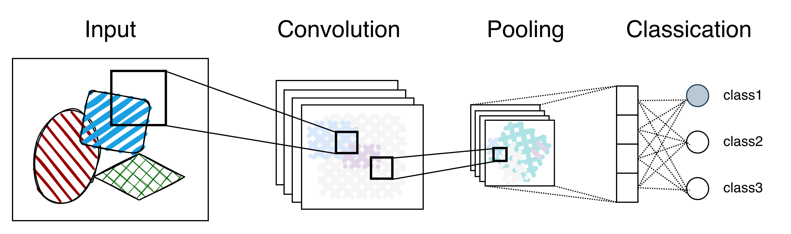
     <dialog id="zoom-image-1"
        onclick="this.close()"
        style="max-width:95vw; max-height:95vh; padding:0; border:0;
               background:transparent; cursor:zoom-out;">
        
    </dialog>           
    <style>
      dialog::backdrop {
        background: rgba(0, 0, 0, 0.8) !important;
          }
    </style>            
                
    <figcaption style="margin-top: 4px; font-size: 16px;">CNN diagram</figcaption>
  </figure>

  <figure style="margin: -200px 0 0; text-align: center;">
    
      <dialog id="zoom-image-1"
        onclick="this.close()"
        style="max-width:95vw; max-height:95vh; padding:0; border:0;
               background:transparent; cursor:zoom-out;">
        
    </dialog>           
    
    <figcaption style="margin-top: 4px; font-size: 16px;">ViT Diagram</figcaption>
  </figure>
</div>
```
::: {style="position: absolute; right: -14px; bottom: -30px; font-size: 12px; line-height: 1.2; color: #555; text-align: right;"}
Source: @transformer @vit
:::

::: {style="position: absolute; left: 20px; bottom: 14px; font-size: 16px;"}
[← Background](#background-menu)
:::

## Hubel and Wiesel Biological Vision Model {#human}

[Background · Human recognition · 1/2]{style="font-size: 0.55em; color: #64748b;"}

<!-- Information flow in a heierachical way -->

Inspiration of CNN

::: nonincremental
-   Local features are eventually integrated into information for recognition
:::

<!-- :::{.nonincremental} -->

<!-- * Retina: electric impulses        -->

<!-- * Retinal/Lateral geniculate nucleus (LGN): respond to local contrast -->

<!-- * Visual area: combine prior signals into more complex visual patterns -->

<!-- * association area: integrate information for recognition -->

<!-- ::: -->

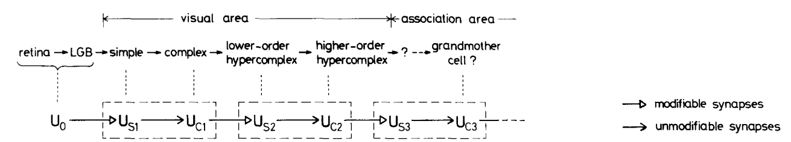 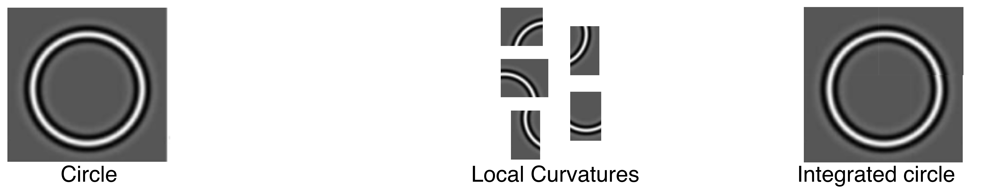{width="800px" style="transform: translateX(100px);"}

::: {style="position: absolute; right: -14px; bottom: -30px; font-size: 12px; line-height: 1.2; color: #555; text-align: right;"}
Source: @Hubel1962 @fukushima1980neocognitron @loffler2003local
:::

::: {.fragment style="position: absolute; left: 20px; right: 20px; bottom: 20px; font-size: 40px; text-align: center;"}
But there's more
:::

## Grouping

[Background · Human recognition · 2/2]{style="font-size: 0.55em; color: #64748b;"}

```{=html}
<style>
  .reveal .slides .fragment.focus-left,
  .reveal .slides .fragment.focus-right {
    visibility: visible !important;
    transition: opacity 0.3s ease !important;
  }

  .reveal .slides .fragment.focus-left {
    opacity: 1 !important;
  }

  .reveal .slides .fragment.focus-right {
    opacity: 0.25 !important;
  }

  .reveal .slides .fragment.focus-left.visible {
    opacity: 0.25 !important;
  }

  .reveal .slides .fragment.focus-right.visible {
    opacity: 1 !important;
  }
</style>

<div style="display: grid;
            grid-template-columns: repeat(2, minmax(0, 1fr));
            gap: 28px; height: 480px;">

  <div class="fragment custom focus-left" data-fragment-index="0"
       style="display: flex; flex-direction: column;
              min-width: 0; color: #111;">

    <h3 style="margin: 50 0 12px; font-size: 48px;">
```
Gestalt Principles (@gestalt)

```{=html}
</h3>

    <ul style="margin-top: 0;">
      <li>
```
Illusory contour is not physically present but is filled by the visual system (@kanizsa)

```{=html}
</li>
      
    </ul>

    <figure style="margin: 30px 10px 0; text-align: center;">
      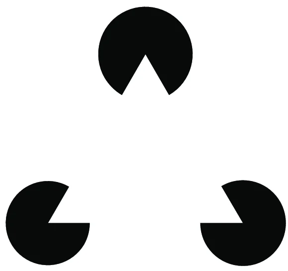

      <figcaption style="margin-top: 6px; font-size: 16px; line-height: 1.2;">
        Kanizsa triangle
      </figcaption>
    </figure>
  </div>

  <div class="fragment custom focus-right" data-fragment-index="0"
       style="display: flex; flex-direction: column;
              min-width: 0; color: #111;">

    <h3 style="margin: 0 0 12px; font-size: 48px;">
      Local and Global
    </h3>

    <ul style="margin-top: 0;">
      <li>
```
Shape discrimination relies on both local curvature information and the global organization of that information (@loffler2003local).

```{=html}
</li>
      
    </ul>

    <figure style="margin: auto 0 0; text-align: center;">
      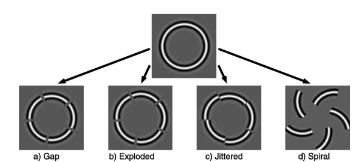

      <figcaption style="margin-top: 6px; font-size: 16px; line-height: 1.2;">
        A circle was split into five identical one-cycle segments and arranged in four different ways.
      </figcaption>
    </figure>
  </div>

</div>
```
::: {style="position: absolute; right: -14px; bottom: -30px; font-size: 12px; line-height: 1.2; color: #555; text-align: right;"}
Source: \@@kanizsa @loffler2003local
:::

::: {.fragment style="position: absolute; left: 20px; right: 20px; bottom: 20px; font-size: 40px; text-align: center;"}
<!-- Organizing features by both local and global information,  -->

Resembles ViT
:::

::: {style="position: absolute; left: 20px; bottom: 14px; font-size: 16px;"}
[← Background](#background-menu)
:::

# Reference

# Average precision {visibility="uncounted"}


<!-- # Appendix -->

<!--  -->
